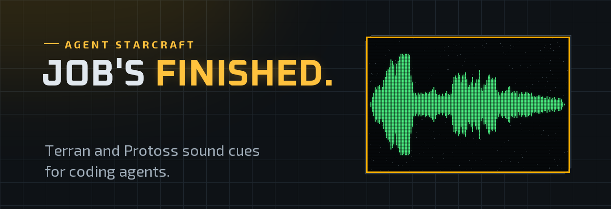
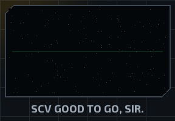
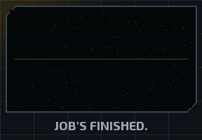
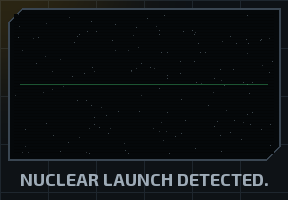
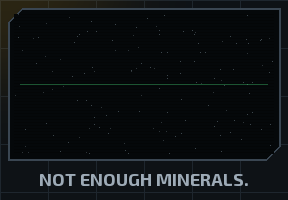
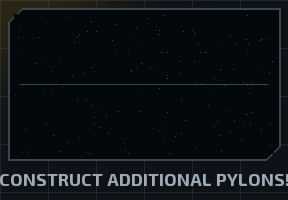
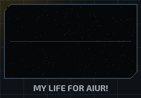

<h1 align="center">
  <a href="https://mitchtech.github.io/agent-starcraft/">
    <picture>
      <source media="(prefers-color-scheme: light)" srcset="assets/previews/banner-light.png">
      
    </picture>
  </a>
</h1>

<p align="center">
  <a href="https://github.com/mitchtech/agent-starcraft/actions/workflows/check.yml"></a>
  <a href="https://github.com/mitchtech/agent-starcraft/releases/latest"></a>
  <a href="LICENSE"></a>
  <a href="audio/NOTICE.md"></a>
</p>

<p align="center"><b>Your coding agent says <i>Job's finished.</i> when it finishes, <i>Not enough minerals.</i> when your usage runs out, and <i>Nuclear launch detected.</i> before a force push.</b></p>

<p align="center">
  <a href="https://mitchtech.github.io/agent-starcraft/"><b>Hear every clip</b></a> ·
  <a href="#sounds">Event map</a> ·
  <a href="#minerals-and-supply-meters">Minerals and supply meters</a> ·
  <a href="https://github.com/mitchtech/agent-starcraft/releases">Releases</a> ·
  <a href="https://github.com/mitchtech/agent-navi">Agent Navi</a> ·
  <a href="https://github.com/mitchtech/agent-johnny5">Agent Johnny 5</a> ·
  <a href="https://github.com/mitchtech/agent-warcraft">Agent Warcraft</a> ·
  <a href="https://github.com/mitchtech/agent-rocky">Agent Rocky</a> ·
  <a href="https://github.com/mitchtech/agent-starwars">Agent Star Wars</a>
</p>

<table align="center">
  <tr>
    <td align="center"><br><sub>Session start</sub></td>
    <td align="center"><br><sub>Turn finished</sub></td>
    <td align="center"><br><sub>Destructive command</sub></td>
    <td align="center"><br><sub>Out of usage</sub></td>
    <td align="center"><br><sub>Context nearly full</sub></td>
    <td align="center"><br><sub>Protoss</sub></td>
  </tr>
</table>

StarCraft sound notifications for coding agents, with a **Terran/Protoss**
toggle. Native sound integrations for **Claude Code**, **Codex**, and **Gemini
CLI**, plus a small event interface for other agents and scripts. One shared
player supports macOS, Linux, and Windows.

Agent StarCraft plays 81 original *StarCraft* and *Brood War* voice lines on
agent events:

- "SCV good to go, sir." when a session starts and "Affirmative." when you send a prompt.
- "Orders, Captain?" when an approval is waiting, and "Nuclear launch detected."
  when that approval is for `rm -rf`, a force push, or a dropped table.
- "Job's finished." when a turn finishes.
- "Not enough minerals." when Claude Code stops on a rate limit or billing error,
  and "Insufficient vespene gas." when a reply hits the output token limit.
- "You must construct additional pylons!" when the status-line supply meter
  says your context window is nearly full.
- "I vote we frag this commander." when you send three prompts in ten seconds,
  exactly as a StarCraft unit reacts to being clicked too often.

Pick **Terran** (SCV, marine, battlecruiser, and adjutant; the default),
**Protoss** (zealot, carrier, dragoon, templar, and advisor: "My life for Aiur!",
"Research complete."), **both**, or **random**, which picks one race per session.
It runs locally, sends no telemetry, and never approves or blocks an agent's
actions.

A sibling of [Agent Navi](https://github.com/mitchtech/agent-navi),
[Agent Johnny 5](https://github.com/mitchtech/agent-johnny5),
[Agent Warcraft](https://github.com/mitchtech/agent-warcraft),
[Agent Rocky](https://github.com/mitchtech/agent-rocky), and
[Agent Star Wars](https://github.com/mitchtech/agent-starwars), inspired by
[thephw/claude-meseeks](https://github.com/thephw/claude-meseeks). For a
large multi-game sound pack registry, see [peon-ping](https://github.com/PeonPing/peon-ping).

## Choose your setup

| Choice | Install | Requirements |
|---|---|---|
| Sounds | [Agent plugin](#install) or standalone CLI | Node.js 22+ and local audio |
| Minerals and supply meters | [Status line command](#minerals-and-supply-meters) | Claude Code status line |
| Codex pets | [Coming soon](#codex-pets-coming-soon) | A host with compatible custom pets |

Installing the sound plugin never installs or selects a pet, and never changes
your status line.

## Sound requirements

- **Node.js 22 or newer**, with `node` on the agent's `PATH`.
- **macOS:** built-in `afplay`.
- **Linux:** `paplay`, `pw-play`, `aplay`, or `ffplay`, with a working local audio device.
- **Windows:** Windows PowerShell (`powershell.exe`), using `System.Media.SoundPlayer`.

No npm runtime dependencies, Bash, or `jq` are required. Windows hooks and audio
playback do not require Git Bash. A headless machine without an audio device
cannot play sounds on your laptop automatically.

## Install

### Claude Code

```bash
claude plugin marketplace add mitchtech/agent-starcraft
claude plugin install starcraft@agent-starcraft
```

Inside a Claude Code session, the same steps are `/plugin marketplace add` and
`/plugin install`.

### Codex

```bash
codex plugin marketplace add mitchtech/agent-starcraft
codex plugin add starcraft@agent-starcraft
```

Review and trust the installed hooks in Codex's hook settings before using them.
Installing or enabling the plugin does not automatically trust its hook commands.
Restart the agent after installation or updates.

### Gemini CLI

```bash
gemini extensions install https://github.com/mitchtech/agent-starcraft
```

Gemini selects a self-contained ZIP for your platform from GitHub Releases.
Review the extension's hook consent prompt and restart Gemini. For local
development:

```bash
npm run gemini
gemini extensions link ./dist/gemini
```

The repository root is for shared sources and discovery; Gemini's executable
hook file is included in the generated extension, not the source root. Install
published release assets rather than linking the repository root or a raw Git
branch. See [Gemini integration](docs/gemini.md).

### Running alongside the sibling plugins

Agent Navi, Agent Johnny 5, Agent Warcraft, Agent Rocky, Agent Star Wars, and
Agent StarCraft all respond to the same events. Enable one per host unless you
want a fairy, a robot, a peon, an Eridian, two droids, and an SCV talking over
each other. For example,
`claude plugin disable warcraft@agent-warcraft` for Claude Code, or
`enabled = false` under `[plugins."warcraft@agent-warcraft"]` in
`~/.codex/config.toml` for Codex.

### Local development

```bash
git clone https://github.com/mitchtech/agent-starcraft.git
cd agent-starcraft
node scripts/starcraft.mjs doctor
```

Use `claude plugin marketplace add /absolute/path/to/agent-starcraft` for Claude Code or
`codex plugin marketplace add /absolute/path/to/agent-starcraft` for Codex, followed by
the same plugin installation command above. `claude --plugin-dir /absolute/path/to/agent-starcraft`
tries it for one session without installing.

### Standalone command

For the `agent-starcraft` command outside an agent plugin:

```bash
npm install -g github:mitchtech/agent-starcraft
agent-starcraft doctor
agent-starcraft play approval_required --session my-session --tool Bash
agent-starcraft preview terran-scv-jobs-finished
```

All commands also work as `node /path/to/agent-starcraft/scripts/starcraft.mjs ...`.
Standalone `play` and `preview` wait for the short clip; native hooks dispatch
playback to a detached worker so the agent can continue immediately.

## Codex pets (coming soon)

The **SCV** and the **Probe** have reserved slots as native Codex pets. Their
manifests, the installer, validation, and release packaging are in place; the
artwork is not bundled yet. Until it ships, `agent-starcraft pet install` (or
`pet install probe`) reports that the pet is not bundled and changes nothing,
and `pet status` reports `not-bundled`. Codex's native pet feature can create a
pet in the meantime. See [Codex pets](docs/pets.md).

## Sounds

Each event lists the Terran lines first, then the Protoss lines.

| Shared event | When | Terran / Protoss | Default |
|---|---|---|---|
| `session_started` | A session starts, resumes, or clears | "SCV good to go, sir." "Battlecruiser operational." / "My life for Aiur!" "Carrier has arrived." | On |
| `prompt_submitted` | You send a prompt | "Affirmative." "Roger that." "Right away, sir." "Orders received." "Go, go, go!" "Outstanding." "Rock and roll." "Make it happen." / "Thus I serve." "Honor guide me." "It shall be done." "My path is set." "Commencing." "Confirmed." "So be it." | On |
| `annoyed` | Your third prompt inside ten seconds | "I can't believe they put me in one of these things." "I told 'em I was claustrophobic. I gotta get outta here!" "I vote we frag this commander." "If it weren't for these damn neural implants, you'd be a smoking crater by now!" "We are getting way behind schedule." / "And still you procrastinate!" "Command, or you will be relieved." "This is not an idle threat." "Your thoughts betray you." "I find your lack of control disturbing." "It is said that ignorance is bliss. Tell me, is that true?" | On |
| `approval_required` | A tool needs permission | "Yes, sir?" "Orders, Captain?" / "Instructions?" "Your command?" "Command me." | On |
| Approval for shell commands or file edits |  | "I read you." / "State thy bidding." | On |
| Approval for a destructive command |  | "Nuclear launch detected." "Base is under attack." / "Nuclear launch detected." "We are under attack!" | On |
| `input_required` | The agent asks you a question | "Receiving transmission." "Input coordinates." / "Awaiting instructions." | On where available |
| `ready_for_input` | Claude Code is idle and waiting | "Reporting for duty." / "I long for combat." "I am needed." "I'm waiting." | On for Claude |
| `turn_completed` | The agent finishes responding | "Job's finished." "Upgrade complete." / "Research complete." "Upgrade complete." | On |
| `out_of_minerals` | Rate limit, billing error, account on hold, or budget spent | "Not enough minerals." / "You have not enough minerals." | On for Claude |
| `minerals_low` | The minerals meter crosses its threshold | "Not enough energy." / "Not enough energy." | On with the meter |
| `out_of_gas` | A reply hits the output token limit | "Insufficient vespene gas." / "You require more vespene gas." | On for Claude |
| `supply_blocked` | The supply meter nears the context limit | "Additional supply depots required." / "You must construct additional pylons!" | On with the meter |
| `error` | Claude Code stops on any other API error | "Landing sequence interrupted." (marine death cry) / (zealot death cry) | Off |
| `tool_failed` | A tool call fails | "I can't build there." "I can't build it. Something's in the way." / (probe error chirp) | Off |
| `subagent_started` | A subagent starts work | "You want a piece of me, boy?" "Somebody call for an exterminator?" "Ready to roll out!" / "I have returned." "Adun Toridas." "Khassar de Templari." | Off |
| `context_compacting` | Context is about to be compacted | "Abandoning auxiliary structure." / "The merging is complete." | Off |
| `session_ended` | A session ends | (SCV destroyed) / (probe destroyed) | Off |
| Easter egg |  | "Nuclear missile ready." "That's the stuff." "In the pipe, five by five." / "En Taro Adun!" "Power overwhelming." | 2% of session, prompt, ready, and completion cues |

`turn_completed` is on by default, as in Agent Warcraft: "Job's finished." is the
line people install this for. `agent-starcraft preset attention` turns it off.

**Destructive commands** are recognized from the approval request's command:
`rm` with recursive and force flags, `git push --force` or `-f` (not
`--force-with-lease`), `git reset --hard`, `git clean -f`, `DROP TABLE`/`DATABASE`/`SCHEMA`,
`TRUNCATE TABLE`, `mkfs`, `dd of=`, `chmod -R 777`, `Remove-Item -Recurse -Force`,
and `rmdir /s`. The alarm is a louder cue, not a safety check: it never blocks,
approves, or logs the command. Only a yes/no flag leaves the hook process.

**Annoyed** lines replace the third and later prompts sent within ten seconds
in the same session, like clicking a StarCraft unit repeatedly. Only timestamps
are stored, never prompt text. Turn them off with `agent-starcraft mute annoyed`.

**Easter eggs** never replace approval, question, error, or destructive-command
cues. Turn them off with `agent-starcraft mute easter-egg`.

Subagent completion is silent. Idle/input notifications and completion events
are distinct; event availability depends on the host. See
[compatibility](docs/compatibility.md).

## Factions

```bash
agent-starcraft faction terran    # SCV, marine, battlecruiser, adjutant (default)
agent-starcraft faction protoss   # zealot, carrier, dragoon, templar, advisor
agent-starcraft faction both      # mix every line
agent-starcraft faction random    # one race per session, kept for the whole session
```

Every default cue has lines for both factions, so switching never silences an
event. Custom clip lists you write in the configuration are filtered the same
way; a list with no clips from the selected faction plays as written. Zerg are
not included.

## Minerals and supply meters

Claude Code's `StopFailure` hook reports why a turn failed. Agent StarCraft maps
`rate_limit`, `billing_error`, and `account_on_hold` to `out_of_minerals`,
`max_output_tokens` to `out_of_gas`, and anything else to `error`. A
`quota_auto_resume_disabled` notification also plays `out_of_minerals`.

For a warning before you run dry, add the meters to your status line. The
minerals meter prints how much of your tightest limit is left and plays "Not
enough energy." once per session when it crosses `minerals.lowPercent` (80%
used by default), then "Not enough minerals." at 100%. The supply meter shows
your context window as supply against the 200 cap and plays "Additional supply
depots required." (or "You must construct additional pylons!") once when it
crosses `supply.lowPercent` (85% by default); compaction drops the meter and
re-arms it. The status line runs outside the plugin, so it needs the
[standalone command](#standalone-command)
(`npm install -g github:mitchtech/agent-starcraft`):

```json
{ "statusLine": { "type": "command", "command": "agent-starcraft statusline" } }
```

```text
◆ 18% minerals (5h) low · 142/200 supply
```

The minerals meter reads Claude Code's 5-hour, 7-day, and spend-limit
percentages when your plan reports them. Set `minerals.budgetUsd` to also count
a per-session dollar budget against `cost.total_cost_usd`. The supply meter
reads `context_window.used_percentage`. To keep an existing status line, call
the meters from your own script; see [minerals and supply](docs/minerals.md).
Codex and Gemini have no equivalent hook; scripts there can run
`agent-starcraft play out_of_minerals`.

## Sound controls

```bash
agent-starcraft status
agent-starcraft faction protoss
agent-starcraft mute prompt_submitted
agent-starcraft unmute prompt_submitted
agent-starcraft mute annoyed
agent-starcraft mute easter-egg
agent-starcraft unmute subagent_started
agent-starcraft mute all
agent-starcraft unmute all
agent-starcraft preset attention
agent-starcraft preset default
agent-starcraft list
agent-starcraft config --effective
```

Changes persist immediately and apply to the next hook, without restarting.
Global mute/unmute preserves individual event preferences.

- The **attention** preset keeps the approval, question, ready, and resource
  alarms (`out_of_minerals`, `minerals_low`, `out_of_gas`, `supply_blocked`). It
  turns off session, prompt, annoyed, completion, error, tool-failure, subagent,
  compaction, and session-end cues.
- The **default** preset restores event enablement. It leaves your custom
  clips, faction, audio directory, easter-egg setting, and global mute
  preference unchanged.

The bundled `starcraft-control` skill also handles requests such as "mute the
SCV", "switch to Protoss", "turn off the annoyed lines", or "set up the supply
meter" inside supported agents. It uses the bundled CLI, so no global npm
installation is needed. `status --json` and `list --json` provide structured
output. Status shows when `AGENT_STARCRAFT_MUTE` overrides the saved global mute
setting.

## Configuration

Configuration stays outside plugin caches, so updates preserve your settings:

- macOS/Linux: `~/.config/agent-starcraft/config.json`, or `$XDG_CONFIG_HOME/agent-starcraft/config.json`.
- Windows: `%APPDATA%/agent-starcraft/config.json`.

Create the parent directory and save the settings you want to override:

```json
{
  "muted": false,
  "audioDir": "./audio",
  "cooldownMs": 1000,
  "faction": "random",
  "minerals": { "budgetUsd": 20, "lowPercent": 75 },
  "supply": { "lowPercent": 90 },
  "easterEgg": { "chance": 0.05, "clips": ["protoss-archon-power-overwhelming"] },
  "events": {
    "session_started": { "clips": ["terran-scv-good-to-go"] },
    "approval_required": { "clips": ["terran-scv-orders-captain"], "changeClips": ["terran-scv-i-read-you"], "dangerClips": ["terran-adjutant-nuclear-launch"] },
    "subagent_started": { "enabled": true },
    "context_compacting": { "enabled": true }
  }
}
```

Omit `audioDir` to use bundled clips. Relative directories resolve from the
configuration file's directory. Custom audio directories must contain a
`<clip>.wav` for every name in `agent-starcraft list`; use 16-bit PCM WAV for
compatibility with all players. Copy the clips to your own directory before
replacing them. Installed plugin files can be overwritten by updates.

How clip settings work:

- An event's `clips` array selects one sound at random, after the faction
  filter. Use one entry for a fixed sound.
- `changeClips` applies to shell and file-change approvals.
- `dangerClips` applies to destructive-command approvals and takes priority.
- `easterEgg.chance` is a probability from 0 to 1.
- `minerals.budgetUsd` is `null` (rate limits only) or a positive dollar amount.
  `minerals.lowPercent` and `supply.lowPercent` are between 0 and 100.
- Each event accepts `enabled: false` to mute it independently.

`agent-starcraft config` prints the complete default configuration without
writing anything.

| Environment variable | Effect |
|---|---|
| `AGENT_STARCRAFT_MUTE` | `1` mutes; `0` unmutes; overrides `muted` |
| `AGENT_STARCRAFT_CONFIG` | Explicit configuration file path |
| `AGENT_STARCRAFT_AUDIO_DIR` | Overrides the audio directory |
| `AGENT_STARCRAFT_STATE_DIR` | Overrides the local playback state directory |

Configure environment variables before starting the agent.

Repeats and overlaps are handled like this:

- Repeated events within `cooldownMs` for the same agent, session, and event are
  suppressed.
- A global playback lock drops overlapping clips across sessions.
- Claude's delayed permission notification is suppressed for at least 10 seconds
  after a matching approval alert. A permission notification without a preceding
  alert can still play.

State contains hashed event and session identifiers with timestamps or meter
levels only. Inactive records are cleaned up after a day, when another sound plays.

## Other agents

Call the shared interface when your agent emits an attention event:

```bash
agent-starcraft play session_started --session example
agent-starcraft play prompt_submitted --session example
agent-starcraft play approval_required --session example --tool Bash --command "rm -rf build"
agent-starcraft play turn_completed --session example
agent-starcraft play out_of_minerals --session example
```

Every event honors its configuration toggle. Integration scripts should treat
playback failures as advisory. No tool-call or transcript polling is needed.

## Troubleshooting

```bash
node scripts/starcraft.mjs doctor
node scripts/starcraft.mjs preview terran-scv-good-to-go
```

`doctor` reports configuration, paths, player availability, clips, the faction,
enabled events, easter eggs, the meters, and the optional pet. `doctor --pet`
checks only the SCV (or `doctor --pet probe`, the Probe) and works without an
audio player or valid sound configuration. These commands operate without
playing anything.

`preview` plays a clip even when muted and bypasses event cooldown, but still
respects overlap prevention. A busy player is reported explicitly instead of
silently skipping the preview. Neither command changes settings.

Native hooks exit successfully on malformed input, invalid configuration, missing
audio/player, or playback failure. They produce no prose or permission decisions.
Codex `Stop` and every Gemini hook emit only `{}` as neutral JSON required by
those hosts. The status-line meters always print a line, falling back to a bare
`◆`. Run diagnostics when sounds are missing, and check Node's availability and
hook trust settings.

SSH, containers, WSL, and cloud sessions play on the machine executing the hook.
An audio bridge must already exist if you expect those sounds on another machine.
GitHub marketplace installation is the distribution path; this hook plugin is
not submitted to OpenAI's public plugin directory.

## Development

```bash
npm run check
npm test
npm run test:package
python3 -m pip install -r requirements-dev.txt
python3 scripts/build-audio.py --check
python3 scripts/check-pet.py
python3 scripts/build-assets.py
python3 scripts/package-release.py
npm run site
```

Tests simulate players. They cover:

- host payloads and destructive-command detection
- faction filtering, the random race, the annoyed window, and usage alarms
- the minerals and supply meters and their once-per-session cues
- easter eggs, configuration, deduplication, and overlap
- the not-bundled pet stubs, failures, paths with spaces, and packaging

CI runs Node 22 and 24 on macOS, Linux, and Windows. See
[compatibility](docs/compatibility.md) and [release notes](CHANGELOG.md).

Python/Pillow are development tools for audio provenance, asset validation, and
previews, not runtime dependencies. `build-audio.py` rebuilds the clips from
[their recorded sources](audio/sources.json) with ffmpeg; `--check` verifies the
committed files offline. See [distribution maintenance](docs/distribution.md)
for releases and the site, and [contributor instructions](CONTRIBUTING.md) for
the project workflow.

## Credits and license

- Author: [Michael J. Mitchell / mitchtech](https://github.com/mitchtech).
- *StarCraft* and *StarCraft: Brood War* (1998), and *StarCraft II* (2010): Blizzard Entertainment. StarCraft is a trademark of Blizzard Entertainment.
- Clip sources: StarCraft Wiki (starcraft.fandom.com) file pages.
- Sibling projects: [Agent Navi](https://github.com/mitchtech/agent-navi), [Agent Johnny 5](https://github.com/mitchtech/agent-johnny5), [Agent Warcraft](https://github.com/mitchtech/agent-warcraft) (whose runtime this project is built on), [Agent Rocky](https://github.com/mitchtech/agent-rocky), and [Agent Star Wars](https://github.com/mitchtech/agent-starwars).
- Original plugin inspiration: [thephw/claude-meseeks](https://github.com/thephw/claude-meseeks).

Code and configuration: [MIT](LICENSE). Bundled audio is excluded; see the
[audio rights notice](audio/NOTICE.md). Third-party character rights and
trademarks remain with their owners. This is a fan project, not affiliated with
or endorsed by Blizzard Entertainment.
