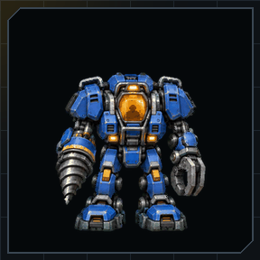
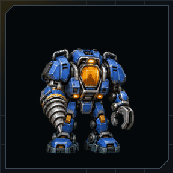
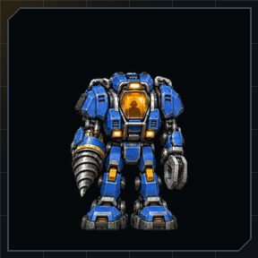

# Codex pets

The **SCV** and **Probe** are bundled as native Codex v2 pets with nine animation
states and sixteen clockwise look directions. Sounds and pets install independently.

<p align="center">  </p>

## Installation

From this source checkout:

```bash
node scripts/starcraft.mjs pet install
node scripts/starcraft.mjs doctor --pet
node scripts/starcraft.mjs pet install probe
node scripts/starcraft.mjs doctor --pet probe
```

With a CLI package that includes the artwork, use `agent-starcraft pet install`
and `agent-starcraft doctor --pet`. Pet-enabled releases include
`agent-starcraft-scv-pet.zip` and `agent-starcraft-probe-pet.zip` for manual
installation. Extract the `scv` or `probe` directory under your configured
Codex home's `pets` directory:

```text
~/.codex/pets/scv/
  pet.json
  spritesheet.webp
  LICENSE.txt
  NOTICE.md
```

If `CODEX_HOME` is configured, use `<CODEX_HOME>/pets/scv/` instead. Manual
installation needs no Node.js, Python, audio player, or sound plugin.
Preserve a backup before replacing a different existing pet.

Installation never changes the selected pet. Refresh the compatible host's
pet picker and choose **SCV** or **Probe**, or enter `/pets SCV` or `/pets Probe` in a graphics-capable Codex
CLI terminal. Claude Code and Gemini use this repository's sounds; no native
pet integration for those hosts is provided here. Account pets are separate
from the local bundle.

## Web upload

[agent-starcraft-scv-pet-web.webp](../assets/exports/agent-starcraft-scv-pet-web.webp)
and [agent-starcraft-probe-pet-web.webp](../assets/exports/agent-starcraft-probe-pet-web.webp)
are transparent 1536 x 1872 WebP files below the 20 MiB upload limit. Each contains
the nine standard animation rows, omitting the two local look-direction rows.
Pet-enabled releases include the same file. `scripts/export-pet-web.py`
writes it from the active atlas, and `scripts/check-pet.py` verifies that its
decoded pixels match the active animation rows exactly.

Upload this image through a compatible web pet creation flow. Keep the artwork
attribution and [CC BY 4.0 license](../pets/scv/LICENSE.txt) when sharing it.
A web upload creates a separate account pet; it does not install or select
the local Codex bundle. The original eleven-row PNG passed the Pets account
creation validator; the repository's nine-row web export is structurally
validated but has not been separately uploaded.

## Installer behavior

The CLI copies the four bundle files and a local ownership record into
`$CODEX_HOME/pets/scv` (default `~/.codex/pets/scv`). An identical installation
is a no-op. A matching manual installation remains unmanaged.

Different files require `agent-starcraft pet install --replace`. The previous
entire directory is renamed to `scv.backup-<unique-suffix>` beside the new
installation. Files and symbolic links at the target directory path are never
replaced. Uninstall removes only an unchanged CLI-owned installation and
refuses edited files, unknown additional files, symbolic links, or unmanaged
installations.

```bash
agent-starcraft pet status --json
agent-starcraft pet uninstall
agent-starcraft pet status probe
```

Both pets install independently and can coexist. Older manifest-only packages
retain their missing-art behavior. `pet status` exits 0 for `not-bundled`, while
`doctor --pet` exits 1 until the requested artwork is available.

## Artwork and validation

The active atlases live in `pets/scv/spritesheet.webp` and
`pets/probe/spritesheet.webp`. Original PNGs are preserved byte-for-byte in
`assets/original/scv` and `assets/original/probe`, following Agent Warcraft.
Lossless WebP encoding preserves every decoded RGBA pixel. Source, active,
and web-export hashes are recorded in `assets/scv-pet-revision.json` and the
[SCV artwork notice](../pets/scv/NOTICE.md). The Probe hashes and reviewed
creation limitations are recorded in `assets/probe-pet-revision.json` and
the [Probe artwork notice](../pets/probe/NOTICE.md). Its saved artwork passed
structural validation, but the original workflow stopped before account
creation at a scanline heuristic that flagged external space between prongs.

| File | Purpose |
|---|---|
| `pet.json` | Local manifest: `id`, `displayName`, `description`, `spriteVersionNumber: 2`, `spritesheetPath` |
| `spritesheet.webp` | Transparent RGBA atlas, 1536 x 2288: 8 columns x 11 rows of 192 x 208 cells |
| `LICENSE.txt` | Contributor artwork rights under CC BY 4.0 |
| `NOTICE.md` | Provenance, character credit, and source hashes |

Rows, in order: idle (6 frames), moving right (8), moving left (8), waving (4),
jumping (5), failure (8), waiting (6), working (6), review (6), and two look
rows of 8 frames covering sixteen directions clockwise from up. All 73 used
cells contain artwork; all 15 unused cells are transparent with zero hidden
RGB residue.

`python3 scripts/check-pet.py` validates the local atlas and web export.
`python3 scripts/build-assets.py` generates the README and site previews.
`python3 scripts/package-release.py` includes both four-file pet ZIPs and web
atlases automatically. The existing real-art installer and package tests
exercise both bundles in isolated directories; small fixtures retain conflict
and missing-art coverage. Native desktop and terminal rendering remain
unverified for the local bundle.

The art is original generated artwork. No sprites, portraits, or models were
extracted from Blizzard games. The artwork license applies to the
contributor's rights; StarCraft, the SCV, the Probe, and their related
trademarks belong to Blizzard Entertainment. This project is not affiliated
with or endorsed by Blizzard.
